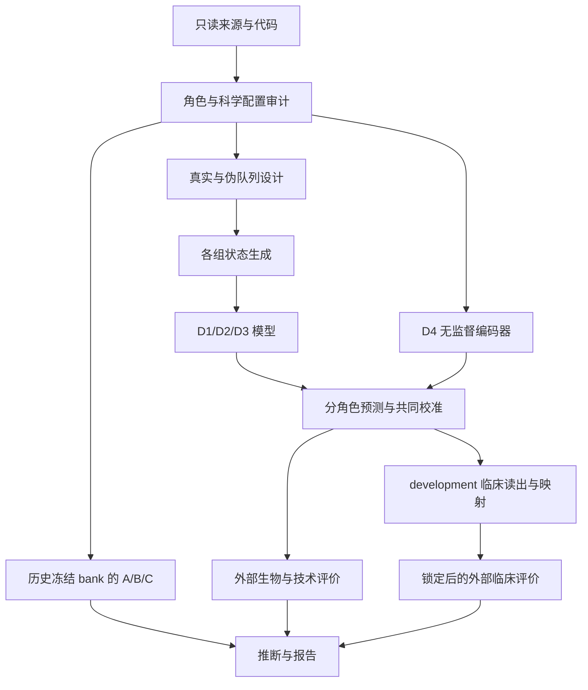

# ablation-03-max：跨队列知识归因与训练策略比较分析计划

日期：2026-10-29。实施状态更新于 2026-11-01 01:37：**本计划规定的正式训练、生物／临床评价、预设敏感性、matched A/B/C 与报告均已执行，69 项执行与结果合同检查通过，最终正式入口退出 0。主设计与共同参考填补各 1,125 个树作业、各 15 个 autoencoder，组织内自由混合 675 个树作业，历史与 matched A/B/C 各 500/100/5 分支全部保留。45 个 D1 cohort 的历史表达、标签及固定 calibration probe 预测完全复现。科学主结论仍不可估计：45 项生物比较均未满足完整训练设计门禁，严格患者／研究别名独立性也尚未证实。整体状态为 executed_with_not_estimable_primary，不将计算完成视为真实队列分组优势已经成立**。

实施记录：独立工程位于 `test/ablation-03-max/`，实际阶段与验证证据见其 README 和 `analysis-plan.yaml`。负责人已澄清 QL1706 是 LSY 两个分析队列的论文名，对应 `LSY01_PD1XCTLA4_LUNG`／`LSY01_PD1XCTLA4_NPC`。2026-10-30 根据负责人指定的论文项目及其已确认纠错记录，撤回本计划将历史外部评价推断为参与筛选的判断：20 个推导队列用于映射选择；Kim2018、Zachary2024、Binghua2024 和 QL1706 为独立验证，未参与模型或映射选择。新增比较沿用这一分工。尚未执行的比较不计为完成。

分析工程拟设于 `test/ablation-03-max/`；大型数据与计算产物统一放在 `D:/cache/ccs_ablation-03/ablation-03-max/`。本计划承接 `CCS_ablation03_updated_plan.md` 的科学问题，将实施位置调整为独立工程。现有 ablation-03 作为只读参考，不在其中新增 `02.05.00` 或改写正式结果。

## 通俗解释：这次准备回答什么

现有分析已经观察到：经过多个队列模型评价后，同一批患者的远近关系发生了变化。接下来要判断，这些变化是否利用了不同队列各自学到的有效知识，以及真实队列边界在学习中是否重要。

例如，固定一批训练患者，一次按真实医院分别训练模型，另一次把患者在合适的组织和平台分层内混合后重新分组，再训练数量和规模相近的模型。医院对应 cohort，重新分组对应伪队列；比较它们对未参与训练患者的表现，可以检验真实来源分组的价值。由于局部状态标签和组内分布也会随分组改变，这仍是完整学习策略的比较。

完成后，报告应能分别说明：真实患者响应是否必要、不同模型是否互补、邻域重排是否具有生物选择性、真实来源分组是否优于替代训练方式，以及这些差异能否帮助外部 ICI 应答预测。成功标准是得到可信的比较，允许阳性、接近和不利结果。

## 专业判断与本地调研依据

### 参考代码可以复用什么

| 已阅读材料 | 已确认的作用 | 新分析的处理 |
|---|---|---|
| `routine01/04.01.PADv20240911_Model training.R` | 使用表达和 subtype 调用 `ccs()`，给出历史 GSClassifier 参数 | 作为 D1 复训和 D1/D2 同模型族比较的起点，不直接运行整个旧脚本 |
| `routine01/04.07.01.PADv20250720_Select01.R` | 过滤 bank，搜索 UWOT/聚类参数，训练预测 metaCCS 的神经网络 caller，评价临床应答 | 复用数据衔接、预测与 caller 思路；其网络是监督式 caller，不能充当 D4 无监督编码器 |
| 同一脚本中的外部评价和保存条件 | 可定位外部 AUC 的计算及保存代码，不能单凭其确定论文实际选择流程 | 实际数据角色以负责人已确认的论文及纠错记录为准；新比较明确只在开发侧选型，外部只评价 |
| `CCS_Data/03.02.PanCanGEO+cBioProtal+UCXCXena_PADv20240810.R` | 筛选 cohort 和基因，组内 quantile 填补，调用 `PAD()`，生成字符标签并排除极小类别组 | 从填补前表达重建各训练臂，重新生成状态，保留筛选和失败原因 |
| `GSClassifier/R/app_PAD.R` | 组内基因标准化；分别对 PIAM、PIDG 做 Ward.D2 二分，再组合 PAD 状态 | D1/D2/D3 使用同一算法，按各自分组重新估计。名义 PAD 标签相同，不代表患者分配相同 |
| CCS 的 `R/ccs_model.R`、`R/ccs_embedding.R` | `fitEnsembleModel()` 训练局部模型，`parCallEnsemble()` 产生概率输出 | 优先使用分析内薄封装组织训练和预测，不改公共 API，不继承旧的文件存在判断式恢复逻辑 |

`04.01` 的参考参数为：`n=50`、`sampSize=0.8`、`ptail=0.1`，CPU、`nfold=5`、固定 `nrounds=50`、`eta=0.3`、`gamma=0.05`、`alpha=0.05`、`max_depth=6`、`colsample_bytree=0.8`、`min_child_weight=1`。这些是拟复现的历史设置，不是本轮已验证的最优参数；线程数按新工程预算配置并复核确定性。

### 轻量盘点发现的实际约束

- 历史训练 RDS 含 **193 个 cohort、39,112 条样本记录、32 个基因**；174 个 cohort 有 4 类状态，19 个只有 3 类，最小已观察类别人数为 3。记录数尚未按跨来源患者去重，不能直接称为独立患者数。
- 填补前的 `Unclassified.rds` 可访问，含 **247 个 cohort、43,935 条样本记录**，存在非有限表达值。其范围大于最终训练数据，不能未经审计全部并入某一训练臂。约 5.6 GB 的完整表达源可定位，本轮未加载。
- 原 ablation-03 manifest 记载 **150 个模块、583 个 d1 概率列、529 个 Direct 特征**，reference 为 147 个 cohort。模块、reference cohort 和上游 cohort 数量并非同一统计对象，须先核对来源对应。
- 历史数据有 `Undefined` 组织，须复用项目已审计的 tissue mapping，同时保留原始 bank 身份和恢复后的组织标签。
- 本机为 32 个逻辑 CPU、约 64 GiB RAM、RTX 4090 约 24 GiB 显存；D 盘当前约有 811 GiB 可用。正式预算以预检时实测为准。
- 原 ablation-03 锁文件记录 CCS 0.8.4，当前仓库版本为 0.8.6。新工程须独立锁定确切包版本与源码，不能将历史结果和当前安装环境默认视为一致。

### 现有结果与新增问题的分工

几何、癌种 readout、decoder、五锚点高覆盖验证、同癌种/来源限制、scaling 和 matched-bank 已有结果，不完整重做。新增工作如下：

| 科学问题 | 实验 | 主要新增证据 |
|---|---|---|
| 患者与模型响应的真实对应是否必要？ | A | 真实 d1 与独立模块置乱、联合患者置乱的外部生物效用差 |
| 不同模型是否提供超越重复输出的增量？ | B | 同预算真实新增与复制模块的生物效用增量差 |
| 重排是否优先保留生物相似关系？ | C | 控制 Direct 起始距离后的生物排序偏好 |
| 真实来源边界是否具有独特价值？ | D1 vs D2 | 同批患者、同一模型族的真实/伪队列重训，作为方法学主比较 |
| pooled 或普通非线性编码能否达到类似效用？ | D1 vs D3/D4 | 相同输入和外部评价下的替代训练策略比较 |
| 表示收益能否迁移到 ICI 应答？ | D 的临床层 | 同监督资源的共同读出，以及各臂自己的完整状态映射 |

## 数据、工程与存储安排

### 独立工程和缓存边界

`test/ablation-03-max/` 保留分析源码、配置、独立 renv 锁文件、说明、Rmd/HTML、聚合 CSV 和发表用图。`00.Environment.R` 集中配置路径和依赖，计算函数放在 `R/`，`_targets.R` 为唯一计算依赖图。Rmd 只读取已完成 target 的产物。

新增计算统一使用下列外部目录；本轮不创建或搬迁数据：

```text
D:/cache/ccs_ablation-03/ablation-03-max/
  targets/                 正式 targets store
  inputs/                  派生输入、分块表达与受控样本角色表
  labels/                  各真实/伪/pooled 分组的状态发现结果
  models/                  按策略/组织/设计/种子/模块组织的模型
  predictions/             分角色、分块的预测
  evaluations/             A/B/C/D 中间结果和完整推断
  observability/           主进程、worker 及 CPU/RAM/GPU 观测
  tmp/                     R 临时文件与临时计算
  tests/<run-id>/           隔离 store、测试输入、模型和报告
```

新增患者级矩阵、标签、候选邻居、临床预测和模型均放在上述根目录内，HTML 不嵌入这些记录。原始来源和 `D:/cache/ccs/_ablation-03/` 保持只读，按需引用旧产物，不整库复制。启动 R 前将临时目录指向新缓存的 `tmp/`，避免临时文件落入源码目录或占满系统盘。

新工程不共享旧 `_targets.yaml`，不切换旧 `tar_watch()` 的 store。实施时为 `.gitignore` 增加新工程例外，因为当前 `test/*` 默认忽略此目录；大型产物仍不进入版本库。此项待计划通过后实施。

### 先冻结四类数据角色

| 数据角色 | 允许的用途 | 隔离要求 |
|---|---|---|
| `model_train` | 状态生成、GSClassifier/autoencoder 训练、训练内选型 | 所有训练臂共享同一允许样本总集；按真实 cohort 分组验证 |
| `representation_calibration` | 标准化、PCA、距离定标、共同近邻参考库 | D 主分析优先采用未参与任何臂训练的独立 cohort，不在 external 上拟合 |
| `development` | ICI 读出正则化选择、状态到应答映射 | 与外部临床人群隔离；严格临床比较中不参与表征训练或校准 |
| `external_test` | 冻结方法的生物、技术与临床评价 | 不参与标签发现、特征拟合、早停、选型、映射或参数修改 |

D 默认采用四类角色的严格隔离。校准 cohort 按组织、平台、样本量和可测性选择，不看模型表现；其数量在可行性审计后冻结，须保证剩余训练组仍可有效构建 D2。不满足条件的组织列明不可识别原因。训练集内校准只能作为明确标记的敏感性设计，不能替代主设计后继续称为严格独立。

A/B/C 可先用历史冻结 bank 完成新诊断，保留其原有来源限制。D 使用审计后的训练集合，可能与历史 bank 不同，两层效应不直接相减。取得 matched D1 后，用同一分析函数复核 A/B/C 的关键比较，无需额外训练新模型。

审计区分患者、样本、活检时间点、测序记录和 cohort 标签，检查来源别名、重复发表、同一患者多样本、bank 训练身份、癌种和平台。不同 cohort 名称不能单独证明独立。受控对应表只存外部缓存，项目内导出计数和排除理由。

原文献、历史脚本名单与本地可评价样本应重新对齐。`04.07.01` 的训练名单有 22 个名称，不能直接沿用旧计划“20 cohort、1,177 人”的分母；Zachary 的合并与分药物条目也不能同时当成独立人群。临床主分析限定预先确认的 ICI 治疗与应答定义，其他治疗类别另列资格。

## 具体分析设计

### A：真实患者—模块响应是否必要

比较真实 d1、cohort 内各模块独立整块置乱、cohort 内所有模块联合置乱。reference 与 query 分开处理，保留完整概率块和 cohort 内边际分布。

主要终点为同癌种、跨 cohort 候选池中的五锚点局部生物效用。拟使用 100 个有效置乱设计，记录唯一设计数和无法置乱的队列。Direct 和随机投影使用相同样本、评分和候选池作为参照。真实优于置乱支持患者对应结构的必要性，不能单独确立真实队列边界的独特价值。

### B：新增模型是否超过复制模型的作用

在至少有两个可用模型的组织内固定 base bank，主设计拟取每组织约一半模块，再加入可行且相同数量的真实新模块或 base 模块副本；随机已有模块组用于检查组成变化的影响。模型名额（slot）的配额只按候选池容量确定。

主要效应为 `(真实新增 − base) − (复制扩充 − base)` 的外部五锚点效用差。各组使用相同 query、候选池、模块 slot 数和评价规则。有效秩、冗余及邻域稳定性用于解释，不替代生物效用。

复制会改变已有模块的距离权重。主比较明确 slot 权重，另核对按唯一模型聚合权重后的结果；对数学上完全等价的复制设计，应验证距离和结果保持数值一致。bank 组合去重，只有可行的小候选空间才穷举，不把重复种子计为新实验。

### C：控制原始距离后的生物排序偏好

在同癌种、排除 query 同 cohort 的参考池中，仅用 Direct 距离和来源元数据生成候选配对，然后判断哪一候选的锚点状态更接近 query。比较 d1 与 Direct 把该候选排在前面的概率；Direct 使用实际排序表现，不人为设成 0.5。

拟以两候选 Direct 距离相差不超过相对 5% 为主条件，1%/10% 为敏感性；锚点接近度差至少达到 0.2 个 reference 标准差，0.1/0.3 为敏感性。这是可分辨条件，不是临床重要性阈值。每个 query 的配对数量设固定上限和种子，数值随资格审计冻结，不依据 d1 优势调节。

候选生成不看 d1 或锚点效应，锚点只用于预定义规则下判别生物近者。同距、锚点并列、不可测和候选不足有明确处理。先在 query 内汇总，再到真实外部 cohort，报告癌种、检测类型和已知平台分层。

### D：固定患者总集的训练策略比较

| 实验臂 | 状态和模型怎样产生 | 主要作用 |
|---|---|---|
| D0 Direct | 相同 32 基因产生的完整 Direct 特征，保留 PCA/随机投影参照 | 无 cohort bank 的输入基线 |
| D1 真实队列 | 保留真实 cohort，各组重新填补、生成 PAD 标签、训练 GSClassifier | 目标方法，在与其他臂相同的当前环境中重新训练 |
| D2 伪队列 | 在组织内受约束重排患者，保留组数、规模及可行的癌种/平台组成，重新生成标签并训练 | 与 D1 尽量匹配模型族和组规模 |
| D3 pooled ensemble | 同组织合并同批训练患者，生成共享 PAD 状态，用不同种子训练独立 ensemble 成员 | 统一数据学习后集成的替代策略 |
| D4 autoencoder | 在同一 Direct 输入上，以重构目标训练 MLP，不接收 cohort、PAD 或 ICI 标签 | 普通无监督非线性编码对照 |

**D1–D2 为主比较，D3 和 D4 为必做竞争对照。** 每臂的实际患者、表达处理、状态数、基学习器数和资源消耗均须可核对。

D2 主设计在可行的组织×癌种×平台分层内重分配，保留原始 cohort 身份，审计每个伪组的真实来源混合度。只有改名、没有有效混合的设计无效。平台缺失不视为已匹配平台；单来源分层或组规模限制使混合不可行时，缩小到有依据的可识别人群。组织内自由混合另作敏感性，不替换受约束主设计。

各臂从填补前的共同表达重新生成状态。历史训练 RDS 用于 D1 一致性对照，不能把按真实 cohort 填补后的表达作为 D2 唯一输入。另设置使用共同训练参考规则的填补敏感性，检验效应是否依赖填补方式。组内标准化和标签变化仍属于整套学习策略的差异。

三状态模型保留实际输出，不补造第四类概率列。资格规则在外部评价前冻结，覆盖类别塌缩、极小类别、内部折缺类和单状态模型；某臂失败不能靠事后筛选有利 query 掩盖。预期的不可估计返回原因，程序错误使对应 target 失败。

D3 每组织的外层模型 slot 数尽量与 D1/D2 对齐，但每个成员须实际训练，不能复制 pooled 输出凑数。其成员接触更多训练数据，共同输出预算与计算预算敏感性应分开报告。PAD 层次聚类有平方级距离存储需求，最大 pooled 组织须先测内存，不能因内存不足悄悄换算法。

D4 主架构拟为 `p → 256 → 32 → 256 → p`，p 为相同的 Direct 列数。标准化仅在训练集拟合，三类原生特征采用平衡重构损失。隐藏宽度、学习率和轮数只用 model_train 内按真实 cohort 分组的验证选择，再以冻结设置在全部允许训练患者上重拟合。主潜变量宽度为 32，16/64 为容量敏感性，届时其他臂同步采用相同输出宽度；与 PCA/随机投影一起报告资源—效用曲线。

#### 共同评价与临床归因

D 主分析让各臂经过同一协议的校准和固定维度映射，拟用 32 维，所有拟合仅用校准数据。实际秩不足时保留不可估计，不加噪声补列。报告原始宽度、有效秩、状态预算和实际可用维数；原生 CCS 模块平衡距离另作敏感性。

五锚点沿用已审计的高覆盖基因与背景定义，主评分为共同秩评分，主候选池为同癌种、跨 cohort，`k=15`。核验旧标尺是否适用严格 D 校准集；不适用时在新校准集拟合，为全部臂重算基线并交代差异。每个锚点内各臂使用相同可评价人群，五锚点共同人群作为敏感性。

主要终点为外部局部锚点效用；状态距离结构、C 的排序、癌种读出、技术聚集、成本和冗余为支持证据。RNA 锚点与输入同源，主要说明表示性质，独立临床任务再检验实际迁移价值。

共同 ICI 读出为主临床比较：各臂使用相同 development 人群和 response 定义，分别拟合受限 ridge logistic，正则化仅在 development 内按真实 cohort 分组选择。统一高分代表应答，冻结后评价公开队列及通过访问和独立性审计的 QL1706。ROC 方向不得由外部结局自动翻转。

报告逐 cohort 的成对 AUC 差、95% CI、样本数、事件数，以及适用时的 Brier 分数和校准。临床净获益仅在研究设计、患病率解释和预设阈值允许时评价；历史 DCA/校准绘图不自动成为新方法的证据。

完整状态映射为另一项必要的支持性比较：各臂按统一、预先限定的流程，独立生成自己的 meta 状态和应答映射。状态发现和 caller 在允许的训练/校准侧拟合，状态构建参数按训练内规则冻结，development 用于应答映射。拟固定四级 normCCS；若采用当前 API 的 `cohort_median`，全部臂固定同一目标，不按外部 AUC 在目标函数之间择优。D4 使用预设共同聚类协议。各臂 metaCCS 编号不能强行对齐或套用原 normCCS 映射。

实现时明确区分映射的拟合与应用：仅用 development 生成并保存映射，external 只应用该映射。不能把 development 和 external 拼在一起调用会重新优化映射的评价入口。若现有 API 未直接提供这种分离，在分析内封装并验证，不因此改写公共接口。

Kim2018、Zachary2024、Binghua2024 和 QL1706 沿用已确认的独立验证角色。它们的历史 performance 计算用于评价，没有参与模型或映射选择；本次方法比较只在允许的训练和开发侧拟合，再应用于这些固定外部队列。Zachary 合并队列及其分药物子集不重复计数，QL1706 两组织归属同一试验来源。数据可用性与新的读出流程仍需计算验证，但不把已确认的原研究角色重新列为未决。

### 2026-10-30 自主继续执行

负责人要求先阅读论文并自主推进，不再以资料确认中断工作。论文位于 `E:/iProjects/Manuscripts/CCS/paper`，以 Methods、SM1/SM3 及 `docs/events/2026-10-23-normccs-validation-role-correction.md` 为数据角色依据，只读引用，不修改论文。应答定义为原队列客观应答，RECIST 注释可用时 CR/PR 为 1、SD/PD 为 0；不把包含 SD 的宽口径 response 替代 response.classic。

先纠正来源报告中的角色误判，再通过本工程同一 targets 图执行历史冻结 bank 的 A/B/C。这一阶段继承旧外部 query 和五锚点高覆盖测量合同，条件于既有 bank，不依赖新 D 的严格四角色分配；不得再把 D 的未决事项作为 A/B/C 的全局阻断。置乱与新增模块设计先于效应冻结，记录唯一设计数、无效组、query 内汇总和 cohort 等权推断。

D 的新分配由本地来源证据、样本及表达重复核对和组织／平台可混合性自行构建；未知别名保留限制并作保守来源分组，不臆造患者对应。临床开发名单按论文补充表核对，ICI 主分析排除疫苗和 ACT，保留广义免疫治疗作为敏感性。候选不足时明确具体不可识别组织，继续可识别人群与已授权的轻量复现，不要求负责人重新提供已可由本地材料确认的事实。

### 推断对象与重复设计

锚点指标统一定向为越大越好，A−B 为正表示 A 更有利；原表为损失时记录变号关系。主要估计对象在外部评价前固定：

| 估计对象 | 分析单位与区间 | 检验与校正 |
|---|---|---|
| D1−D2 五锚点效用 | query 内配对，真实外部 cohort 等权，95% cohort bootstrap CI | 五锚点为固定主族，双侧零差检验，Holm 调整 |
| D1−D3、D1−D4 | 同一外部人群，报告效应、CI 和设计分布 | 两比较×五锚点为单独的辅助族 |
| A/B/C | 各自预设对照，先 query 内汇总再按 cohort 推断 | 各自五锚点分别调整，设计分布与 cohort 区间分开 |
| ICI AUC 差 | 同一患者成对，保留逐 cohort 结果，合并时保留 cohort 结构 | D1−D2 共同读出为主，不为描述性指标机械加检验 |

目标重复为 **5 个训练种子×3 套有效伪队列划分**。同一种子的 D1/D3/D4 不随伪分组重复训练，D2 按种子和划分训练。相同 D1 输出多次配对不产生额外独立实验。主推断先按规则平均设计效应，再以经别名和样本重叠审计后的真实外部 cohort 重采样；存在上层共享来源时增加相应来源分组的敏感性。设计不确定性另做分层敏感性，同一抽中的训练设计共同作用于全部 cohort。

拟用 2,000 次有效 bootstrap，记录有效次数。队列过少、事件稀疏、状态不可比较或区间失效时保留不可估计。成对 DeLong 描述固定分数在单一测试集的 AUC 差，不覆盖跨 cohort 和完整重训的不确定性。区间跨零不代表等价；本轮不事后制定非劣效界值。

生物主比较的零差检验拟在 cohort 配对均值层做双侧符号翻转，小规模时精确枚举，否则固定种子做 10,000 次 Monte Carlo。该方法依赖零假设下差值符号可交换的假设，不是患者随机对照；假设或独立来源不成立时保留效应与适用区间，标明检验不能成立的原因，不机械生成 P 值。

## 实施顺序与资源控制

1. **来源和资格审计。** 核对输入、组织恢复、样本别名、训练和历史筛选记录，形成四类角色、临床定义及可识别组织清单，冻结科学配置。
2. **同算法的小规模预检。** 覆盖不同平台、大小及三/四状态 cohort，复核 D1 标签和预测，各运行有效 D2/D3/D4，实测耗时、内存、输出大小和报告链。缩小输入不改变业务算法，预检不等于正式 D 完成。
3. **冻结 bank 诊断。** 完成 A/B/C，核对置乱、复制权重、候选生成及旧基线衔接。
4. **D1–D2 主比较。** 按冻结设计重训、分块预测和评价；D1 差异无法解释时先修复，不混用旧 D1 和新对照。
5. **D3/D4 与容量敏感性。** 完成替代策略和资源—效用比较，在新 D1 输出上复核关键 A/B/C。
6. **临床与报告。** 各臂独立学习读出和状态映射，锁定外部评价，完成推断与正式报告。

若 M 为合格模块数，5 个种子、3 套伪分组且 D3 slot 数相同，D1/D2/D3 合计约 `5M + 15M + 5M = 25M` 次外层拟合。以原 bank 150 个模块仅作尺度示例，是约 3,750 次外层拟合、187,500 个内部 ensemble 成员，尚未计交叉验证和敏感性；这不是已确认的新 D 规模或耗时承诺。

CPU 预检拟用 2 个 crew worker，GSClassifier `numCores=1`、XGBoost `nthread=1`，实测后再考虑 4 个 worker。GSClassifier 单核仍创建 PSOCK 子进程，统计须覆盖子进程。GPU 编码器使用单并发 crew 资源组，限制 torch/BLAS 线程。分别估算模型、预测和缓存占用；资源不足时报告影响，由负责人判断科学范围调整，不悄悄减少种子、样本或训练强度。

### targets 依赖与恢复

新工程采用 targets-first，crew 接入 `tar_option_set()`。启动器只配置路径、renv 和同一 store 的 make/watch/manifest，不逐脚本调度科学计算。



按策略、组织、设计、种子、模块建立动态分支，昂贵拟合返回模型文件，预测按模型和人群分块，不让每个 worker 重载完整表达库。targets 跟踪输入、配置、状态生成代码、版本和模型文件。来源摘要可记录哈希，不另造 cache-hit、SUCCESS 或 checkpoint 系统。

主进程、worker 日志和资源观测写入 `observability/`，CPU/RAM 日志由 `autometric::log_read()` / `log_plot()` 读取，GPU 观测单列。`tar_watch()` 指向实际 store。中断后依 targets 元数据恢复，成功分支应跳过；未完成单模型默认重训，不承诺旧 API 未提供的中途续训。只改报告不重训，只改 D4 不使 A/B/C 或树模型无故失效。

## 交付与验收

拟交付三个可独立阅读的 Rmd/HTML：数据来源与训练资格、A/B/C 冻结模型机制检验、D 训练策略与临床归因。源码可折叠，聚合表可交互查看，科学图导出矢量 PDF。每项比较均报告方向、样本/队列分母、设计数、效应和不可估计原因。

| 验收范围 | 完成证据 |
|---|---|
| 数据与独立性 | 来源和重复样本审计、四类角色、平台混合度、历史临床队列使用说明 |
| D1 复现 | 原始与重生成标签、预测对照；当前环境内可重复；历史差异有解释，不预设逐位相同 |
| 训练公平性 | 相同允许样本和基因、无外部调参；实际状态数、slot、维度、拟合数和成本明细 |
| A/B/C | cohort 内整块置乱；复制不产生新函数；候选仅依赖 Direct/元数据；ties、缺失和小队列处理有效 |
| 临床 | 独立拟合共同读出及各臂映射；固定分数方向；外部结局不参与选择；重复使用如实标注 |
| 同 DAG 轻量执行 | 合成夹具及授权真实子集通过正式 `_targets.R`；覆盖稀有类别、缺失平台、重复患者、无有效混合和小事件数 |
| 恢复与失效 | 隔离 store 中断后正确恢复；成功 target 跳过；数据/配置/代码变化只使正确后代失效 |
| 路径与观测 | 大型文件位于指定 D 盘子树；测试不写正式产物；make/watch 同 store；主/子进程资源可检查 |
| 报告保真 | 图表与计算层同源，统计单位和 CI/P 方法明确，经 humanization 润色后事实、数字、术语和公式不变 |

独立 renv 锁定 R 4.3.1、CCS、GSClassifier、targets、crew、autometric、torch/luz、glmnet 等实际依赖，审计源码和安装工件一致性，不混用旧锁文件中的 CCS 0.8.4 与当前 0.8.6。本任务不修改版本或发布。

实施时同步新工程 README、analysis-plan.yaml、`docs/ablation.md` 和 CHANGELOG，按 BAC 记录来源、变更和验证。状态区分来源预检、同 DAG 轻量执行、正式全量执行；缺 D3/D4 或必要临床比较时为 partial。

## 审查时最需要关注的选择

建议优先审查：**D1–D2 作为主比较；严格数据角色隔离与历史公开队列的验证定位；5 个种子×3 套伪分组的目标规模。** 前两项决定结论能支持到哪一步，第三项决定主要成本。训练清单和并行数在来源审计、同算法预检后冻结，科学范围调整应先展示影响，交由负责人判断。

2026-10-29 的计划初稿阶段仅完成代码阅读、轻量只读结构盘点和计划编写。后续已建立独立工程并完成规定计算，2026-11-01 的执行证据与科学限制见本文开头及工程运行说明。临床结果有 450 行逐 cohort×设计×读出评价及 120 行 D1−D4 成对 AUC 结果；matched 80 项中 45 项可推断、30 项仅效应、5 项为精确复制恒等，预设 primary 项无 Holm 显著结果。这些结果不补足 D1−D2 的完整 bank 和重复缺口。没有减少种子、伪分组、样本、训练强度或容量，也未以新规则替换资格失败。

## 本地依据索引

- [此前修订计划](CCS_ablation03_updated_plan.md)，保留其科学意图，本计划独立规定实施位置和顺序。
- [现有分析说明](../../test/ablation-03/README.md)、[输入边界](../../test/ablation-03/raw/README.md)、[高覆盖配置](../../test/ablation-03/config/biology-high-coverage.yml)。
- [子模型训练](../../R/ccs_model.R)、[概率生成](../../R/ccs_embedding.R)、[临床评价 API](../../R/phenotype.R)。
- `E:/iProjects/RCheck/GSClassifier/routine01/04.01.PADv20240911_Model training.R`，重点为 23–50、79–95 行。
- `E:/iProjects/RCheck/GSClassifier/routine01/04.07.01.PADv20250720_Select01.R`，重点为 34–44、101–153、229–295、311–318 行；定向阅读同系列 04.07.03、04.07.06、04.07.09 和 04.07.10 的相关代码。
- `E:/iProjects/CCS_Data/03.02.PanCanGEO+cBioProtal+UCXCXena_PADv20240810.R`，重点为 34–54、129–178 行。
- `E:/RCloud/RFactory/GSClassifier/R/app_PAD.R` 的 169–309 行、`ModelSeries_fitModels2.R` 的 139–321 行。源码仅作本地参考，实际执行版本以锁定工件为准。
