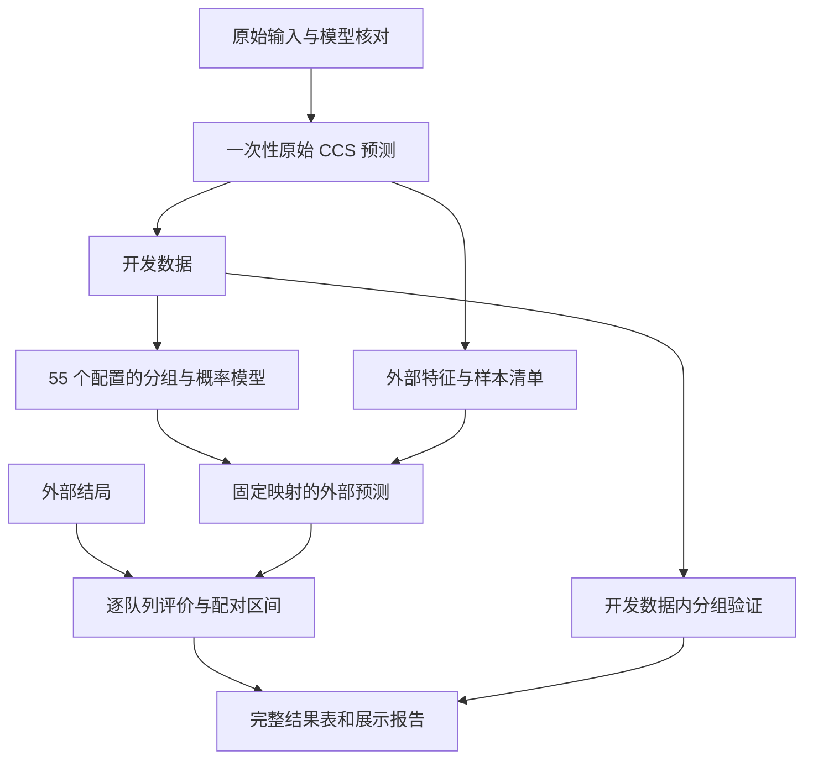

# normCCS-premium：基于原 PAD 数据探索五级及以上分组的分析优化计划

日期：2026-10-29。状态：待实施。代码基线：CCS 0.8.6，当前提交 `82e1b99`。本轮只核对源码、脚本、文件指纹和运行环境，尚未读取患者级记录、重算分组或迁移数据。

## 核心建议

先固定原 PAD 分析采用的 CCS 模型和原始数据，把 normCCS 从 2–4 级扩展到 **5–12 级**，完整比较当前源码支持的五种目标函数。主要交付是不同分组方案的完整外部验证结果，重点展示 **LSY01_PD1+CTLA4_NPC、LSY01_PD1+CTLA4_LUNG、Kim2018_PD1_STAD、Zachary2024_MultiICI_MKCC**，同时保留其他符合预设纳入条件的外部队列。重点展示这四个队列，不等于依据它们的结果定向筛选方案，也不要求最后只保留一个“赢家”。

计算方面直接复用 0.8.6 已有的 DP 搜索和评分模块。科学评价方面，分开回答三个问题：增加等级是否保留了更多应答排序信息；这种表现能否在外部队列复现；额外等级是否有足够样本支撑。若进一步需要推荐默认方案，再用开发数据内的验证结果选择，外部结果用于完整评价和解释。

## 已核对的基础与需要调整的环节

| 位置 | 已核对的事实 | 对本次分析的意义 |
| --- | --- | --- |
| 原 `04.07.03…Subtype normalization.R` | 实际循环为 `2:4`，使用 `NRR`、`OptimizeRank`；将训练与外部队列共同传入分组函数 | 历史重放保留原口径；本轮新映射只从开发数据推导，再应用于外部数据 |
| 原 `04.07.04…Summary.R` | 存在按外部 AUC 排序和阈值筛选的代码 | 本轮完整展示外部结果，不沿用这些筛选规则；这项代码事实不用于推断研究者查看结果的目的 |
| 原 `04.07.06`、`04.07.09`、`04.07.10` | 主要采用模型 `5ff3a2de76e6cf902e765e8224f9cb66` 和固定四级 `record` | 主分析先固定这个模型；原固定映射保留为历史参照 |
| `R/phenotype.R` | 公开接口支持 `norm_search_method`、`norm_objective`；`newSubtype()` 可应用已保存映射 | 无须重新开发高 K 搜索；新增工作主要在分析层 |
| `R/subtype_norm_dp.R` | DP 单核运行，多初值与局部精修，最终逐队列复核原 ROC | 分支间并行交给 targets/crew，单次搜索设置 `numCores = 1` |
| `R/subtype_norm_objective.R` | 五种目标共用评分；四种新增目标排除 pooled `All` | 新分析明确区分目标得分、真实队列 AUC 和 pooled AUC |
| `R/ccs_base.R` | `OptimizeRank` 根据传入数据的结局重排类别；`Raw` 也沿用 pROC 自动方向 | 外部主要 AUC 用独立评价函数固定方向，不能仅靠 `Raw` 参数解决方向问题 |
| 原 DCA、校准辅助函数 | DCA 在各队列内交叉拟合概率；校准函数的列表分支在各队列内拟合并评价 | 保留历史结果；本轮主要校准和 DCA 直接评价开发集模型产生的留出概率 |

当前源码和已安装包均为 0.8.6。已有合成验证记录覆盖 K=5–12，但真实患者验证仍为 `NOT_RUN`；合成运行速度和最优值匹配不能替代本轮真实数据结果。DP 对固定方向的加权均值子问题精确，对目前公开评分过程整体仍为近似搜索。

原脚本没有确认可用的 K=1 搜索：当前接口限定 `n_norm_subtype >= 2`。如需要一级参照，定义为所有人同一级的常数模型，判别 AUC 为 0.5；`n_norm_subtype = NULL` 表示跳过归一化搜索，不能当成一级模型。

## 数据与模型保持一致

沿用 `project_version = PADv20250720`、`data_version = PADv20240810`、`model_version = PADv20240911`。已确认下列文件存在并记录了当前 SHA-256；是否与最初分析时的内容完全一致，仍需结合旧缓存或历史指纹核对。

| 数据 | 原来源 |
| --- | --- |
| PanIMT 表达与临床设计 | `E:/RCloud/database/IMtherapyPlusMolecular/@PanIMT/product/balancedMatrix/v20250629/imt_{expr,design}_PADv20240810.rds` |
| CDS-DB 表达与临床设计 | `E:/RCloud/database/CDS-DB/report/v20241213/cdsdb_{expr,design}_PADv20240810.rds` |
| 主模型原始快照 | `E:/Sync/Project/PADv20250720/models/resCCS_5ff3a2de76e6cf902e765e8224f9cb66.rds` |
| 分析目录内模型快照 | `E:/iProjects/RCheck/GSClassifier/routine01/ccs/PADv20250720/resCCS_5ff3a2de76e6cf902e765e8224f9cb66.rds` |
| 旧临床比较数据 | `E:/iProjects/RCheck/GSClassifier/routine01/ccs/PADv20250720/marker_comparison/PanIMTv20250629+CDSDBv20241213/MultiDesign_WithCCS.rds` |

两份模型文件的大小和 SHA-256 均不同。实施时先比较模型参数、状态定义、scaller 组件及同一输入的预测；若差异只来自附加图表或分析结果，记录后采用与原主分析一致的一份。若预测不一致，应先查清来源，不能随手选择、重训覆盖，或混用两份模型的预测与映射。

主分析固定上游基因特征、cohort bank、降维、聚类、CCS 状态定义及预测器，只研究既有状态如何归并为 normCCS。每个样本的原始 CCS 预测计算一次，供全部 K 和目标函数复用；已有预测缓存须通过模型、输入和行列标识核对后才能复用。旧脚本中的 scaller 重训及覆盖保存逻辑不进入本轮主分析。

实施前建立队列和样本清单，核对 `response.classic` 到 0/1 的转换、缺失值、肿瘤类型、重复样本、同一患者多次取样，以及研究别名和汇总队列与子队列的重叠。患者级关联表保留在外部缓存；展示结果只输出汇总信息。开发与外部角色按预先写明的清单确定，不随任何候选方案的 AUC 改变。原训练列表含 22 个名称，实际独立来源组数和有效人数须在清理后报告。

## 重点外部验证队列如何展示

这些队列明确作为外部验证队列。新分析将它们的特征用于应用固定模型、将结局用于评价；分组排序、切点、目标选择及概率模型的拟合只使用开发数据。历史重放若保留原来的联合推导调用，应单列为历史结果，不与本轮只用开发数据推导映射后的外部评价混合。

| 主要展示名称 | 旧脚本中的相关名称 | 核对要求 |
| --- | --- | --- |
| `LSY01_PD1+CTLA4_NPC` | `LSY01_PD1XCTLA4_NPC` | 用样本对应关系确认一致性 |
| `LSY01_PD1+CTLA4_LUNG` | `LSY01_PD1XCTLA4_LUNG`；部分脚本写作 `LSY01_PD1+CTLA4_LUAD` | 核对样本与病理定义后建立别名，展示沿用负责人指定名称，不直接推断 LUNG 与 LUAD 完全同义 |
| `Kim2018_PD1_STAD` | `Kim2018_PD-1_gastric` | 固定纳入样本和应答定义 |
| `Zachary2024_MultiICI_MKCC` | `Zachary2024_MultiICI_merkel cell carcinoma` | 主展示使用 MultiICI；药物子队列另列，汇总时避免与总队列重复计权 |

每个重点队列均展示全部预设的 K × 目标函数结果，按 K 升序和固定目标顺序排列，不按外部 AUC 筛选、隐藏或只展示最好一行。表现下降、AUC 小于 0.5、等级应答率不单调和区间很宽的结果，同样保留。其他外部队列采用相同评价方法，并提供可检索的完整表。

外部结果的解释保留两层信息：数据来自独立外部队列；本次是对既有队列的扩展再分析，既往曾查看或使用哪些结果应如实说明。重点阅读外部表现本身不改变队列角色。只有具体发生了参与推导、排序或选择的步骤，才需要说明它对相应结果解释的影响。

## 分析矩阵与对照

### 主分析先完成 55 个固定配置

固定主模型、`norm_rank_marker = "NRR"`、`norm_roc_method = "Raw"`，运行 K=2:12 与五种目标的组合，共 **55 个配置**。其中 K=5:12 的 40 个配置是新增探索，K=2/3/4 用于同口径比较。实际 M 为开发数据中出现的状态数，K 不得超过 M；不适用或失败的配置在总表中保留状态和原因。

| `norm_objective` | 当前实现的含义 | 本轮用途 |
| --- | --- | --- |
| `median` | 包含 `All` 的遗留 AUC 中位数 | 衔接旧分析、评价兼容口径 |
| `cohort_median` | 真实队列 AUC 中位数 | 分辨 pooled `All` 带来的影响 |
| `mean` | 真实队列 AUC 等权均值 | 预先指定的主要解释策略 |
| `lower_tail` | 真实队列最低 25% 概率质量的 AUC 均值 | 检查低表现队列驱动的分组变化 |
| `mean_lower_tail` | 均值与下尾均值各占 0.5 | 预设稳健性比较策略 |

下尾边界按比例计入。例如 5 个真实队列时，下尾为 `(a_(1) + 0.25 * a_(2)) / 1.25`。这些是源码中现有的固定定义，不在外部结果出来后调整权重。

不同目标的 `objectiveScore` 含义不同，不能直接比较数值大小来判断哪种策略更好。DP 返回少量实际复核候选，其数量也不能与旧穷举的全组合表行数等同。主报告每个配置展示按其开发目标排序的首个方案；所有返回候选及诊断仍完整保存。若展示同一配置的其他候选，按开发阶段预先确定的顺序展示，不按外部结果重新挑选。

### 对照保持问题清楚

保留原主模型的固定四级 `record`，用于回答“相对于原分析，结果有什么变化”。同时，在当前开发数据边界内，对每种目标重新推导 K=4，作为同目标、同口径对照；K=5–12 对这个四级版本计算配对差值，以区分增加等级与更换目标函数的影响。原固定四级映射的历史选择过程单独注明。

一级常数模型作为可选下限。按开发数据确定顺序的 K=M 映射可作为可选的分辨率参照，但不能把未经排序的 CCS 状态编号直接当作连续评分。主阶段不重新搜索全部历史 `paramMD5`；只有固定模型实验显示值得进一步研究时，才另行设计上游模型比较。

先完成 5–12 的所有整数等级。13–20 的扩展只在开发数据内部显示持续收益、样本支持允许、且实测资源足够时追加；追加条件和配置须在查看新增配置的外部结果前记录。未扩展到更高 K，不构成十二级全局最优的证据。

## 搜索、映射与方向的具体处理

现有搜索空间是在 RR/NRR 排序后的 M 个状态上做连续分段，组合数为 `choose(M - 1, K - 1)`。例如 M=107、K=5 时已有 4,967,690 个切分，仅作为规模示例，本轮以实际 M 为准。主分析显式使用 DP；穷举仅用于规模允许的核对，不通过提高内存保护阈值强跑大组合。

训练调用可以复用现有公开接口；以下只说明拟实施的调用方式，`df_train` 必须已经限定为当前开发训练部分：

```r
fit <- CCS::subtypePerformance(
  data = df_train,
  col_subtype = "CCS",
  col_cohort = "Cohort",
  col_response = "response",
  col_id = "SampleIDs",
  col_tissue = "tissue",
  cohort_level = unique(df_train$Cohort),
  n_norm_subtype = 8,
  norm_rank_marker = "NRR",
  norm_roc_method = "Raw",
  norm_search_method = "dp",
  numCores = 1,
  norm_objective = "mean",
  verbose = FALSE
)
record <- fit$Data$Normalization$Summary$Info[1]
```

应用前显式检查待预测状态是否存在于保存的映射，再调用 `CCS::newSubtype()`；不依赖底层转换函数对未知状态的隐式行为。未知状态记为未覆盖，报告人数、队列分布及覆盖率，不借助外部结局补排，也不静默填入中间等级。各 K 和目标在相同训练状态集合下应有相同映射覆盖范围。

外部主要 AUC 使用数值等级，预先定义“等级越高，预测应答越高”，明确设置正类和方向：

```r
pROC::roc(
  response = y_external,
  predictor = grade_external,
  levels = c(0, 1),
  direction = "<",
  quiet = TRUE
)
```

这个评价函数不重新搜索分组，不执行 `OptimizeRank`，也不把低于 0.5 的 AUC 自动翻转。当前 CCS 的 `Raw` 搜索仍使用自动方向，其训练内 `objectiveScore` 作为候选生成得分单独保存；它与固定方向的留出 AUC 不一定相同。如需选择默认方案，依据后者。只有真实数据核对显示自动方向严重影响候选生成，才另提最小的固定方向接口改造，不在本轮计划中假定现有 API 已具备该能力。

每个配置保存映射字符串、状态顺序、切点、逐队列 AUC、`objectiveScore`、`SearchDiagnostics`、运行时间及输入和源码指纹。DP 的 `exact_global_optimum = FALSE` 保持原义。小规模或可穷举的真实子问题用于核对同目标差距和快速 AUC，一致性不等于全量高维问题已证明最优。

## 开发数据内的稳健性验证

外部结果图谱之外，建议增加按独立来源组留出的验证，判断更细分组是否容易依赖某个开发队列。先固定主模型和主排序，不把模型搜索、四种排序和两种 ROC 方法全部交叉扩展。

主要策略 `mean` 采用外层 leave-one-source-group-out，内层使用预设的 5 折来源组划分；来源组不足时在实施前明确可行的折数。每次训练重新计算 NRR/RR 顺序、分段与映射，不能复用全开发集的顺序预测留出部分。所有 K 使用相同划分。内层评价 K=2:12 的固定方向 AUC；如需要选默认 K，采用队列等权均值及预设的一标准误简化规则，优先较小 K。同一外层留出组仅用于评价，不能再用来决定 K。

一标准误按独立来源组的验证指标估计，并保留组数和计算方法；来源组太少时只作描述性比较，不给不可靠的标准误规则。`mean_lower_tail` 可按相同划分完成预设的次要验证；其余三种目标先完成固定配置的外部描述，只有要对它们提出额外泛化或择优结论时再补相同验证预算。

外层可同时保存各固定 K 的表现曲线与内层选定 K 的表现，二者分别代表固定配置和选择流程。不能看完外层曲线后选最高 K，并把同一曲线中的数值当作已独立验证的最优性能。

本阶段估计的是“给定当前已选 CCS 模型，更换 normCCS 映射”的表现。固定该模型进行嵌套映射验证，不能消除上游模型历史选择的影响，也不构成从零开发整个 CCS 系统的无偏验证。若以后比较多个 `paramMD5`，模型选择也必须纳入相应的训练过程。

## 高 K 的样本支持与分组解释

每个分组输出开发集及各外部队列的等级人数、应答/非应答人数、应答率与 Wilson 95% 区间、空等级、极小等级，以及相邻等级的应答率变化。外部队列没有出现全部 K 个等级可以是正常的分布差异，不据此重新定义分组。

建议将下列条件作为推荐默认方案时的预设检查：开发数据每级人数至少 `max(20, ceiling(0.01 * N_train))`，应答和非应答分别至少 5 人，并由至少 3 个独立来源组支持；同时报告映射覆盖率，以 95% 作为需要进一步检查的预设界线。这些是本计划建议的操作标准，需要在正式运行前确定，不是已验证的临床标准。不能要求每个小型外部队列的每一级都满足这些人数。

样本支持不足的方案仍进入完整结果表并保留外部表现，只标明其解释限制，不作为默认方案推荐。当前 DP 没有公开的最小等级人数约束；对返回候选做检查并不等于找到了约束空间的最优解。若确有必要寻找满足人数约束的替代切分，再单独设计约束搜索和验证，不能无说明地合并小等级。

不同 K 的切点由各自目标独立推导，不一定构成嵌套分组。展示原四级与新等级的交叉分布、患者排序一致性和等级迁移，避免把所有变化都解释成“四级内部进一步拆分”。映射稳定性可在预先固定 K 的开发数据重采样中评价，包括切点变化、标准化等级变化和成对顺序一致性；不同 K 不直接比较原始等级编号。

## 外部评价指标与区间

每个配置、每个外部队列至少报告样本数、应答数、覆盖率、固定方向 AUC 与 95% 区间，以及相对同目标 K=4 的配对 ΔAUC。全部方案使用相同纳入规则；仅在 AUC 无法定义时报告不可估计及原因，不因某个方案表现差而删除队列。主要比较在共同可评价样本上进行，同时报告全纳入人群的覆盖情况。

对外部固定方案采用队列内按结局分层的 1,000 次配对 bootstrap，同一重复的样本索引供全部方案使用；存在患者重复记录时按患者抽样。区间反映给定已训练方案在该外部队列的评价不确定性，不包含重新开发模型和选择 K 的全部不确定性。开发集重采样的映射稳定性与此分别报告。

重点四队列分别给出结果，汇总的队列等权均值作为辅助描述；不能用总体均值掩盖某队列下降。对包括重叠来源的全部外部数据，先指定不重叠的汇总集合，bootstrap 以独立来源组为单位处理。单纯合并患者计算的 pooled AUC 另列，不能替代队列内 AUC。

本轮以效应量和区间描述为主，不按每个单元格的 p 值筛选结果。若后续要声称多个 K 或多个队列中的显著优势，先界定比较族并采用 Holm 等多重比较校正；普通 95% 区间不会自动提供整张结果矩阵的同时置信保证。

### 校准和 DCA 使用真正留出的概率

normCCS 等级不能直接除以最大等级后当作应答概率。每个配置在开发训练部分拟合预先指定的两参数 logistic 模型，以 `grade / (K - 1)` 为预测量；保存系数后生成留出概率。内部验证时只在相应训练部分拟合，最终外部评价时使用全部开发数据拟合后的固定系数。一级参照采用训练应答率。若拟合分离或不收敛，保留等级 AUC，概率指标记为不可估计并说明原因，不临时用外部数据补拟合。

先保存样本级留出预测，再由纯评价函数计算 Brier score、校准曲线、校准截距/斜率及 DCA。校准截距/斜率的估计属于对固定概率的诊断，不能把重校准后的概率替换原预测后再声称校准良好。

DCA 延续原阈值范围 0.05–0.40 和重点范围 0.10–0.30，明确纳入两个端点；同表给出 treat-all、treat-none 和配对净获益差。应答预测的决策解释需要说明具体决策场景，不能仅凭应答结局的净获益曲线推出 ICI 相对不治疗的因果获益。

现有 `get_dca()` 会重拟合，`evaluate_calibration()` 的列表分支也会重拟合，均不直接承担本次主要外部概率评价。可保留它们作为“队列内重新拟合”的单独补充分析；新的主要评价只接收已经保存的 `response`、`grade` 和 `predicted_probability`，不再次训练。

## 代码、结果与外部缓存的布局

按负责人指定，分析目录为 `E:/RCloud/RFactory/ccs/test/normCCS-premium/`，主要数据统一托管在 `D:/cache/ccs/normCCS-premium/`。以下为拟建结构，本轮尚未创建或搬入分析数据。

```text
test/normCCS-premium/
  README.md
  normCCS-premium.Rproj
  00.Environment.R
  config.yml
  renv.lock
  _targets.R
  R/                         # 输入核对、分组、留出评价、报告函数
  scripts/                   # 环境准备和 targets 启动/监测工具
  tests/                     # 小型代码生成测试，不含患者数据
  reports/
    normCCS-premium.Rmd
    normCCS-premium.html
    figures/                 # 重要 PDF/PNG 展示图
    tables/                  # 汇总结果与可读映射表，不含患者级数据

D:/cache/ccs/normCCS-premium/
  raw/                       # 原输入的只读快照、来源与内容指纹
  models/                    # 确认后的模型快照
  metadata/                  # 数据/模型/代码清单及受保护的样本对应信息
  derived/                   # 清理后的临床表和一次性 CCS 预测
  search/                    # 全部配置的候选、映射及 DP 诊断
  validation/                # 内外层划分、训练结果及样本级留出预测
  bootstrap/                 # 重采样索引、结果及可复现种子
  targets/                   # 本分析唯一正式 targets store
  observability/             # 主进程、worker 日志与 CPU/RAM 资源记录
  environment/               # 分析专用依赖库及下载缓存
```

原数据按来源建立快照，复制前后核对内容指纹并保留原文件；已存在且指纹一致的快照直接复用。所有原始和生成的主要数据，无论体积大小，均写入外部缓存。报告只导出重要展示图和汇总表，避免将大对象嵌入 HTML 或放到代码目录。测试夹具由代码生成，需要落盘时也写入配置指定的隔离缓存。

`CCS_NORMCCS_CACHE_ROOT` 作为可配置缓存位置，默认采用上述 D 盘路径；路径解析集中处理，不散布绝对路径。代码、配置及锁文件保留在分析目录，依赖库与包缓存指向 `environment/`。不与已有 `test/normCCS-5-more` 合成基准或 `test/ablation-03` 的 store、环境及数据缓存混用。

正式缓存内容发生变化时创建新的配置/内容标识，不按“同名文件已存在”跳过科学计算，也不覆盖来源不明的旧结果。展示文件由相应 targets 更新，所有重要图表可以追溯到配置、模型、映射和评价表。

## targets 流程与资源安排

本分析从实施开始采用一个正式 `_targets.R`。输入文件以文件 target 追踪，额外记录内容指纹；全量运行、增量更新、失败恢复和报告均通过同一依赖图。外部结局只进入评价函数，映射推导函数的输入限于开发数据。



单次 DP 继续单核，配置、留出组和重采样分支的 target-level 并行通过 `crew` controller 接入 `tar_option_set()`。先用 2 个 worker 完成真实规模试运行，按每个 worker 的实测内存和耗时再决定是否增加；BLAS/OpenMP 线程数固定，避免内外层线程相乘。主进程 runtime logging、worker-specific 日志及 CPU/RAM 指标全部写入 `observability/`，可由 `autometric::log_read()`/`log_plot()` 读取或展示。

独立 R 4.3.1 进程核验显示，默认库已安装 CCS 0.8.6、renv 1.2.4 和 pROC 1.18.5，尚不能加载 targets、crew、autometric。这只是默认库状态，不代表其他项目环境也缺少它们。实施时先准备本分析专用环境并固定依赖；不能因环境未准备好改用另一套脚本调度产生正式结果。

以下是拟实施后的 R 会话用法，当前不执行；启动与监测必须使用同一个 store：

```r
setwd("E:/RCloud/RFactory/ccs/test/normCCS-premium")
Sys.setenv(CCS_NORMCCS_CACHE_ROOT = "D:/cache/ccs/normCCS-premium")
source("renv/activate.R")
store <- file.path(Sys.getenv("CCS_NORMCCS_CACHE_ROOT"), "targets")
targets::tar_make(script = "_targets.R", store = store)
# 在另一个已加载相同分析环境的 R 会话监测：
targets::tar_watch(store = store)
```

正式计算前，用同一 DAG、小型代码生成数据和独立 cache root 验证恢复与报告流程。正式 store 不删除重建；新增目标或修订报告依赖正常增量更新。搜索输出、bootstrap 和报告分别缓存，文字调整不触发分组重算。

## 分阶段实施与验收

| 阶段 | 主要工作 | 完成标准 |
| --- | --- | --- |
| 数据与历史基线 | 核对模型快照、原数据和重点队列别名，保存固定四级参照 | 来源和指纹可追溯；开发/外部角色、重复关系及应答编码明确 |
| 搭建分析流程 | 准备专用环境、D 盘缓存、正式 DAG 和独立评价函数 | 代码生成数据贯通同 DAG；恢复、store 监测及日志位置一致 |
| 真实数据试运行 | 固定主模型，先运行 K=4/5/8/12、`mean` 与 `mean_lower_tail` | 映射、方向、覆盖与原 ROC 复核通过；获得真实耗时和内存记录 |
| 完整结果展示 | 补齐 K=2:12 × 五目标，应用于全部外部队列 | 55 个配置逐项有结果或明确状态；四个重点队列完整展示 |
| 稳健性与概率评价 | 主要策略的来源组验证、配对区间、等级支持、校准和 DCA | 留出预测可重建；不在外部重排或重新拟合主要预测 |
| 交付 | 生成报告、图表和汇总表，更新 README、CHANGELOG 与贡献记录 | 重要结果来自正式 targets；表达润色后复核事实、数字、代码和链接 |

试运行只用于核对实现和资源，不根据其外部结果删改正式配置。正式计算量和运行时间在真实试运行后估算，不把已有合成数据的秒级计时直接外推。若嵌套验证成本较高，先交付全部固定配置的外部结果图谱，再完成已声明的内部验证，报告中明确各项完成状态。

实施时重点验证以下性质：修改外部结局不会改变训练顺序、映射或预测；固定方向评价保留 AUC<0.5；未知状态明确计入未覆盖；所有方案共享相同评价样本和 bootstrap 索引；重叠队列不被重复汇总；中断后通过原 DAG 恢复，不改动旧分析产物。除非实施修改了包源码，否则不为纯分析项目重新触发全包开发或升版流程。

## 预期交付

核心图表为四个重点外部队列的 K–AUC 曲线与区间、K × 目标函数的配对 ΔAUC 图、等级人数/应答率图，以及原四级到新等级的交叉分布。图中固定标出原四级参照，按预设顺序展示全部有效配置。

完整汇总表包括各外部队列的结果、映射覆盖与样本支持、训练目标与外部指标、DP 诊断及失败原因。校准与 DCA 作为独立板块，清楚区分训练得到的固定概率与补充的队列内重拟合结果。报告给出哪些分组在何种队列上改善、持平或下降及其不确定性，不预设高 K 一定更好。

本轮计划不修改 CCS 版本、原固定四级映射、原 PAD 脚本或已有模型文件；实施后的项目变更记录到 `[Unreleased]`。

## 依据与可追溯资料

源码依据为 [phenotype.R](../../R/phenotype.R)、[subtype_norm_dp.R](../../R/subtype_norm_dp.R)、[subtype_norm_objective.R](../../R/subtype_norm_objective.R)、[ccs_base.R](../../R/ccs_base.R)。既有工程证据见 [合成验证记录](../../test/normCCS-5-more/objective-verification.md)；前期算法与目标定义见 [DP 计划](CCS_normCCS_DP_search_optimization_plan_2026-10-29.md)和[目标函数计划](2026-10-29-normCCS-objective-strategies.md)。本文按当前实现制定真实数据分析方案，不将前期计划中的“待实现”状态当作现状。

原分析证据来自 `E:/iProjects/RCheck/GSClassifier/routine01/` 的 `04.07.03`、`04.07.04`、`04.07.06`、`04.07.09`、`04.07.10`；概率评价行为另核对了 `E:/iProjects/candidateR/get_dca/get_dca.R` 和 `evaluate_calibration/evaluate_calibration.R`。当前文件指纹、运行环境与公开文献核验保存在本轮任务工作区。

方法学补充只做了与本任务直接有关的四篇定向核对，不是系统综述。已核对 DOI 和题录，并阅读 Varma、Vickers 文献的公开摘要；其余两篇核对公开索引信息。以下文献支持验证设计、评价或报告原则，不用于证明本项目某个 K 或目标函数更优。

- Varma S, Simon R. *Bias in error estimation when using cross-validation for model selection*. BMC Bioinformatics, 2006. [10.1186/1471-2105-7-91](https://doi.org/10.1186/1471-2105-7-91)。模拟研究支持将模型选择和误差评价分开。
- Steyerberg EW, Harrell FE. *Prediction models need appropriate internal, internal-external, and external validation*. Journal of Clinical Epidemiology, 2016. [10.1016/j.jclinepi.2015.04.005](https://doi.org/10.1016/j.jclinepi.2015.04.005)。对应来源组留出与外部验证的设计区分。
- Vickers AJ, Elkin EB. *Decision Curve Analysis: A Novel Method for Evaluating Prediction Models*. Medical Decision Making, 2006. [10.1177/0272989X06295361](https://doi.org/10.1177/0272989X06295361)。对应预设阈值和净获益的决策解释。
- Collins GS, et al. *TRIPOD+AI statement: updated guidance for reporting clinical prediction models that use regression or machine learning methods*. BMJ, 2024. [10.1136/bmj-2023-078378](https://doi.org/10.1136/bmj-2023-078378)。对应数据角色、模型过程和评价结果的透明报告。
